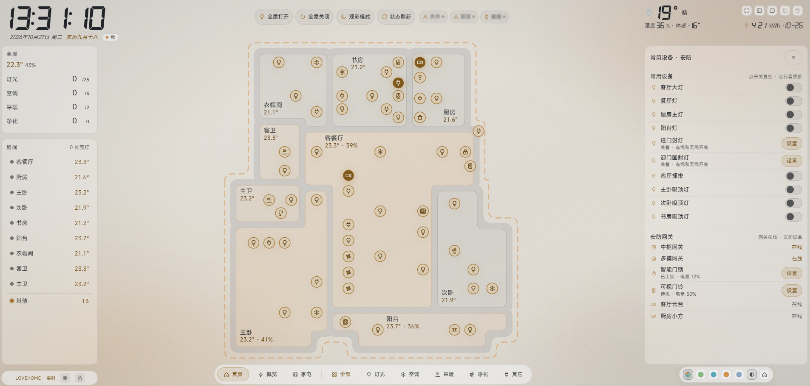
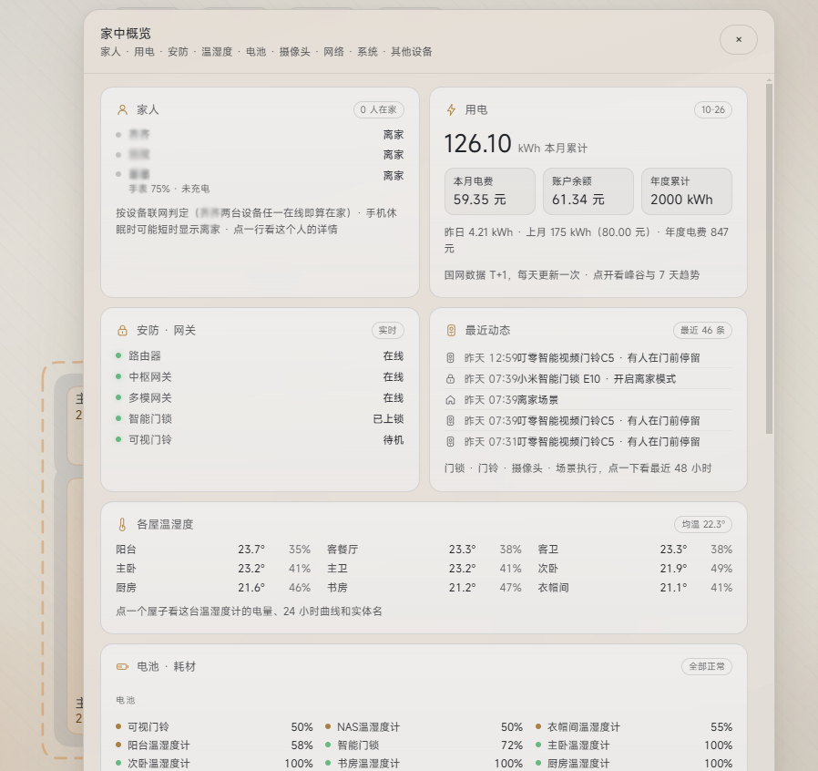
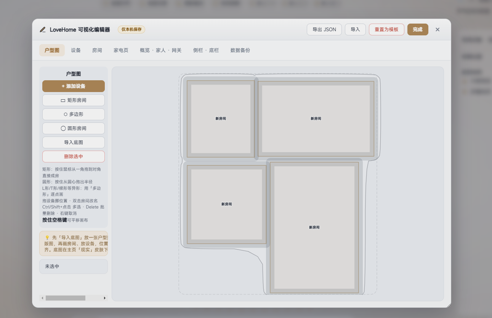
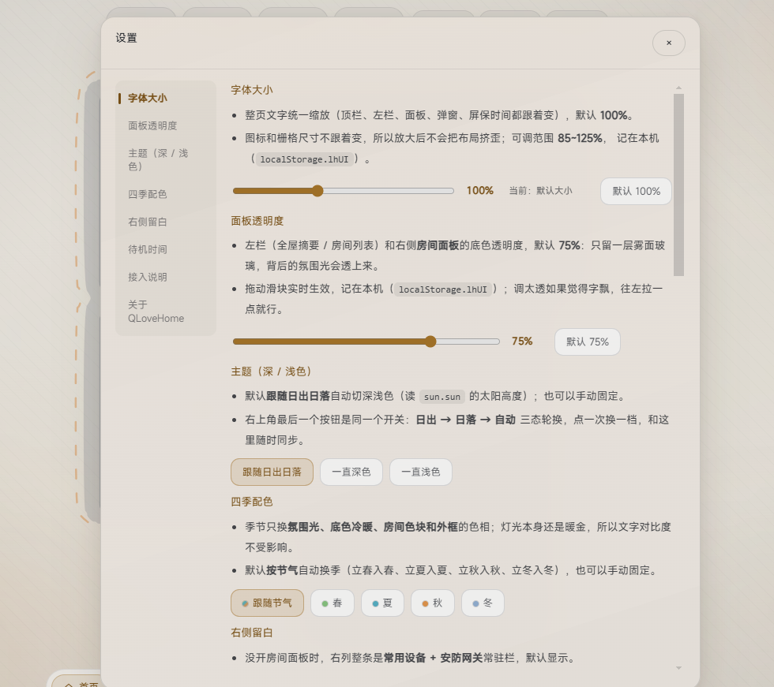
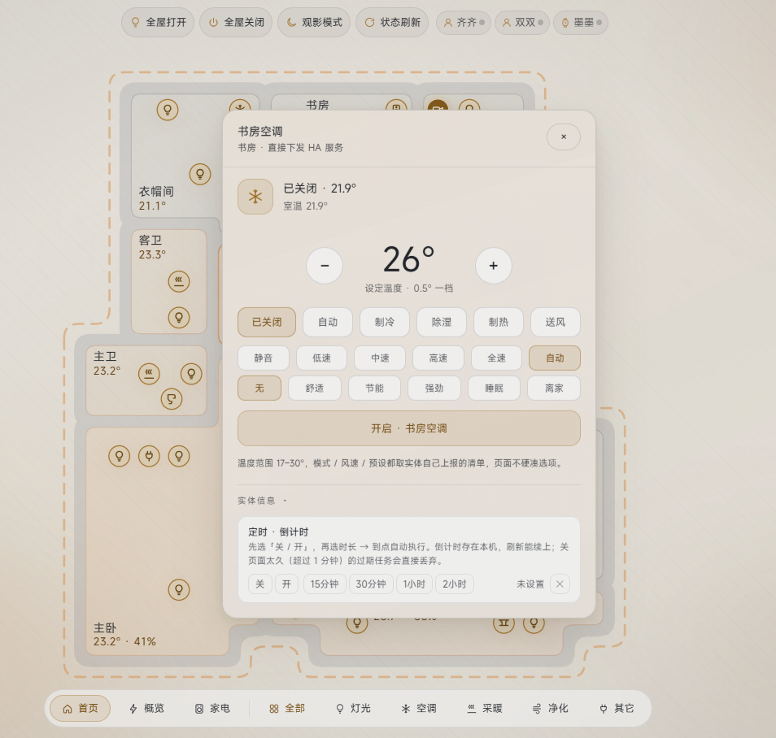

# 🏠 QLovehome · 全屋大屏

[](https://www.home-assistant.io/)
[](https://hacs.xyz/)
[](LICENSE)
[](https://github.com/MisiteQ/QLovehome/issues)
[](https://github.com/MisiteQ/QLovehome/stargazers)

面向门口 / 客厅平板的 **Home Assistant 全屋大屏面板**。
纯 iframe 嵌入，零 YAML，零 Webpack——HTML + SVG + JS，源码可读可改。

---

## 💬 写在前面

QLovehome（**其爱家** 哈哈哈）是怎么来的？

> 新房子装修（开发商的精装房，几乎没啥装修的）之后，有几个灯的开关我老婆说不太好按，让我给她弄个方便操作的方式。当时没有接触过 HAOS，从淘宝上搜了几个蓝牙的还有那种"机器小手指头"的，但都不好用。
>
> 因为家里有个米家的摄像头，所以接触到了米家的智能开关，慢慢的就把家里的开关（主要是灯具，没换灯）都换成了米家的。后来又陆陆续续添加了部分米家的小家电，不过空调洗衣机还是用的美的的。
>
> 慢慢发现米家和美的不通，操作啥的还得俩 App。后来就接触到了 HAOS。不过对我一个小白来说，布置仪表盘啥的太麻烦了，中间停停弄弄的，一直也没弄成。
>
> 头几天在肥牛群里和群友交流，有人推荐了一个仪表盘我挺喜欢的。刚好最近 AI 都很火，我就尝试让 AI 给我布置了一个基础的，发现嘿，比我自己弄好多了！然后就让 AI 参照群友推荐的基础上给我布置了一个——不过这个是 AI 纯代码写出来的，和原来那个可能就在样式上有些相似，其他的都是现写的代码（我自己弄不明白 😅）。
>
> 发群里让大伙看，有人提出是不是可以弄成模板，所以就有了现在这个 QLovehome。是一个基础模板，可以手动设置自己家的户型，也可以直接导入平面图。
>
> **共享给大家，试试看吧，不会的交给 AI，一句话让他给你布置，哈哈哈！** 🎉

---

## ✨ 功能

| 模块 | 说明 |
|---|---|
| 🏠 **户型图** | 矢量 SVG，矩形 / 多边形 / 圆形房间，墙体自动融合一体 |
| 🎛️ **中控** | 灯光 · 插座 · 空调 · 风扇 · 窗帘统一开关 + 调光调色温 |
| 📊 **概览** | 家人在线 · 用电 · 安防 · 温湿度 · 电池 · 摄像头 · 网络 |
| 🎨 **主题** | 深/浅色跟随日出日落 · 四季配色自动切换 · 房间色块温度感知 |
| 😴 **屏保** | 无操作自动进待机大屏时钟 · 待机时间可配置 |
| 🛠️ **编辑器** | 可视化画户型 · 空格平移画布 · 滚轮缩放 · 拖房间名字定位 |
| 🔧 **个性化** | 字体大小 · 面板透明度 · 主题深浅 · 待机时间 · **全部存 HA 服务器**（换电脑/换浏览器不丢） |

---

## 📸 截图

| 首页（浅色主题） | 概览面板 |
|:---:|:---:|
|  |  |

| 编辑器 · 户型绘制 | 设置面板 |
|:---:|:---:|
|  |  |

| 房间详情（空调中控） | |
|:---:|:---:|
|  | |

---

## 🚀 安装

### ⚠️ v1.0.0 升级到 v1.0.1

v1.0.0 的 `__init__.py` 在 HAOS 上 setup 会报错（`panel_custom` API 签名变了）。**v1.0.1 已修复**。
如果你之前装过 v1.0.0：**卸载旧版本 → 重新安装 v1.0.1**，或者手动替换 `__init__.py` + 重启 HA。

### 方式一：HACS 自定义存储库（推荐）

1. **HACS → 集成 → 右上角 ⋮ → 自定义存储库**
2. URL 填：`https://github.com/MisiteQ/QLovehome`
3. 类别选：**集成**
4. 搜索 **QLovehome** → 安装 → 重启 HA
5. **设置 → 设备与服务 → 添加集成 → QLovehome**
   - 侧边栏自动出现 **QLovehome** 入口 → 点进去就是
   - 如果没出现 → Dashboard 添加「网页卡片（iframe）」→ 地址：
     ```
     /qlovehome/www/index.html
     ```

### 方式二：纯 iframe（最简）

```bash
# 复制前端文件到 HA www 目录
cp -r custom_components/qlovehome/www/ /config/www/qlovehome/
```

Dashboard → 网页卡片（iframe）→ 地址：
```
/local/qlovehome/index.html
```

### 方式三：手动复制集成

```bash
# 复制整个集成目录
cp -r custom_components/qlovehome/ /config/custom_components/
# 重启 HA
```

---

## 🔌 接线

### ⭐ 推荐：编辑器「从 HA 批量导入」（v1.1.0+）

**不用改任何 Python 脚本！**

1. 主界面 → 设置 → 打开编辑器 → **设备 tab**
2. 点 **🔍 从 HA 批量导入**
3. 弹窗里按 domain 分组列出你 HA 里所有控制类实体（灯 / 开关 / 空调 / 窗帘 / 风扇 / 影音 / 门锁 / 摄像头...）
4. 勾选你家的设备 → 点「导入 →」
5. 系统自动：推断 kind（light 实体 → 灯图标）+ 取 friendly_name 当设备名
6. 继续配房间归属 + 户型图位置 → 保存

> 已经绑定过的实体会自动灰掉避免重复。超过 30% 设备实体不存在时 tab 头会显示黄色告警。

### 进阶：改 gen_qlovehome_data.py（适合大量设备 / 自定义房间名）

```bash
# 1. 改 gen_qlovehome_data.py 里的实体 ID 和房间
# 2. 生成数据层
python gen_qlovehome_data.py

# 3. 把生成的 qlovehome-data.js 传到 /config/www/qlovehome/
# 4. index.html 里的 ?v=N 加 1（浏览器缓存）
```

> **实体 ID 对不上不会报错**，只会显示「—」。先用批量导入跑通主要设备，特殊实体（概览里的家人/用电）再手改 gen 脚本。

---

## 🗺️ 换户型

| 方式 | 怎么做 | 适合 |
|---|---|---|
| A. 直接用模板 | 什么都不改 | 先看效果 |
| B. 现实风照片底板 | 照片存 `assets/plan-real.jpg`，跑 `python calib_real.py` | 想让照片当底板 |
| C. 重新提取多边形 | `python extract_rooms.py 标注图.png 户型图.png` | 户型完全不同 |

`rooms_poly.json` 是**唯一几何源头**——墙体、房间色块、标签位置全由它推导。

---

## ⌨️ 编辑器快捷键

| 操作 | 效果 |
|---|---|
| <kbd>Space</kbd> + 拖动 | 平移画布 |
| 滚轮 | 缩放（以鼠标位置为锚，0.3× ~ 5×） |
| <kbd>Ctrl/⌘</kbd> + <kbd>0</kbd> | 重置缩放和位置 |
| 矩形房间 | 按住从一角拖到对角 |
| 圆形房间 | 按住从圆心拖出半径 |
| 多边形 | 逐点点击画异形 |
| 双击房间 | 改名 / 拖拽房间名字移动 |
| <kbd>Delete</kbd> / <kbd>Backspace</kbd> | 删除选中 |
| <kbd>Ctrl/⌘</kbd> / <kbd>Shift</kbd> + 点击 | 多选 |
| 右键 | 取消当前操作 |

---

## 📂 项目结构

```
QLovehome/
├── .github/workflows/validate.yaml   # CI: HACS + Python + JS 语法校验
├── .gitignore                        # Git 忽略规则
├── .hacsignore                       # HACS 下载包过滤
│
├── custom_components/qlovehome/       # ⭐ HA 自定义集成
│   ├── __init__.py                    # integration 注册
│   ├── config_flow.py                 # HA 配置向导
│   ├── const.py                       # 常量
│   ├── manifest.json                  # 集成元信息（version / domain）
│   ├── strings.json                   # 配置向导文案
│   ├── translations/                  # 多语言（en / zh-Hans）
│   └── www/                           # 前端静态文件（HACS 部署用）
│       ├── index.html
│       ├── qlovehome.js                # 主界面 + 几何算法
│       ├── qlovehome-editor.js         # 可视化编辑器
│       ├── qlovehome.css               # 全部样式 + 四季主题
│       ├── qlovehome-data.js           # 数据层（gen 脚本生成）
│       ├── QLovehome.png              # 项目图标
│       └── assets/                    # 背景图（bg-day / bg-night / plan-real）
│
├── qlovehome/                        # 前端源码（开发用，同步到 www/）
│
├── gen_qlovehome_data.py               # ⭐ 数据生成器（改实体 ID 跑这个）
├── extract_rooms.py                   # 从标注图提取房间多边形
├── calib_real.py                      # 现实风底板校准
├── calib_real.json                    # 校准输出
├── rooms_poly.json                    # 房间多边形坐标（唯一几何源头）
├── photo_outline.json                 # 户型外轮廓
├── missing_ents.json                  # 未接入设备清单（运行时读取）
├── templates.yaml                     # HA template sensor 示例
├── optional-patches/
│   └── patch_midea5.py                # 美的 AC LAN 兼容补丁（可选）
│
├── QLovehome.png                      # 项目图标（根目录）
├── hacs.json                          # HACS 自动发现配置
├── info.md                            # HACS 安装后展示页
├── LICENSE                            # MIT
└── README.md                          # 本文件
```

---

## 🛠️ 开发

```bash
# 本地静态服务器
py -m http.server 8765 --directory qlovehome/

# 改完同步到 custom_components
copy qlovehome\. custom_components\qlovehome\www\ -Recurse

# CI 自动校验：Python 语法 · JS 语法 · manifest.json · HACS Action
```

### 核心几何算法

| 函数 | 作用 |
|---|---|
| `unionPolys()` | 多边形并集 + 扩张（扫描线 + Marching Squares） |
| `autoOutlineLoops()` | 户型自动外轮廓 |
| `traceLoops()` | 无方向端点连接串闭合环 |
| `scanlineFill()` | 每多边形独立扫描线填充 |
| `chaikin()` | Chaikin 算法平滑 |
| `roundPath()` | 带贝塞尔倒角的 SVG path |

---

## ❓ 常见问题

| 现象 | 原因 | 解决 |
|---|---|---|
| 🆕 **Error setting up entry for qlovehome** | v1.0.0 的 panel_custom API 签名在 HA 2024.6+ 不兼容 | 升级到 **v1.0.1**（已修复） |
| 侧边栏没出现 QLovehome | panel 注册可能失败 | Dashboard 手动加 iframe 卡片 → `/qlovehome/www/index.html` |
| 页面空白 | iframe 地址错 / 文件没传 / `?v=N` 没加 | 确认 Dashboard 卡片 URL；确认 `/config/www/qlovehome/` 下有 index.html |
| 全是「—」 | 实体 ID 没换成你的 | 打开开发者工具 → 控制台输 `LH.rooms.map(r=>r.lxs)` 看实际读的是什么 |
| 图标有但点不动 | 该设备的 HA 服务不存在 | HA → **开发者工具 → 服务** → 搜该设备 → 手动触发试试 |
| 改了没生效 | 浏览器缓存 | `?v=N` 加 1；还不行 Ctrl+Shift+R 硬刷新 |
| 手机侧栏不见 | 正常：≤900px 窄屏模式自动隐藏 | |
| 墙体太厚 | `LH.plan.wallW` 默认 3px | 编辑器里改房间形状后重新生成，或 Console 输 `LH.plan.wallW=10` |
| 待机时间想调 | 设置面板 | 设置 → 待机时间面板 |

---

## 📝 更新日志

| 版本 | 日期 | 变更 |
|---|---|---|
| **v1.3.4** | 2026-10-28 | 🏠 默认模板补上**过道 + 卫生间**（6 个房间铺满画布，每房一盏示例灯）；🐛 修复 HA 顶栏隐藏时报 `getElementById is not a function`（逐层扫描 shadow root 时对 Document 兼容取样式节点）；🩹 服务器配置只剩 `timers` 段时不再被误判为「已配置」，可正常回落到默认模板 |
| **v1.3.3** | 2026-10-28 | 🏠 默认模板改为**4 个房间铺满画布 + 每房一盏灯**（移除原来开发者自带的户型）；🪟 修复隐藏 HA 顶栏按钮无效（兼容 Lovelace `.header` 与新版 `ha-top-app-bar`，逐层注入 shadow DOM） |
| **v1.3.2** | 2026-10-28 | 👨‍👩‍👧 家人支持**一位家人挂多台设备**（手机 / 手表 / 平板）：编辑器里「+ 设备」逐个添加，任意一台在线即算在家；家人详情页会列出每台在线状态 |
| **v1.3.1** | 2026-10-28 | ⏱️ 定时 / 倒计时改由 **HA 服务器调度**：存在集成自身目录 `qlh/qlh-config.json` 的 `timers` 段，关面板 / 退出 HA 账号 / 换电脑都照常执行；支持**手动输入分钟数**（1~1440） |
| **v1.1.0** | 2026-10-27 | ⭐ 新增**编辑器批量导入**：从 HA 实际实体列表勾选创建设备（按 domain 分组、自动推断 kind/名字）；设备 tab 缺失实体告警；接线方式升级为「批量导入优先」 |
| **v1.0.1** | 2026-10-27 | 🔴 修复 `async_setup_entry` 崩溃（panel_custom API → frontend 内置注册）；manifest iot_class 改为 calculated |
| **v1.0.0** | 2026-10-27 | 首个正式发布：户型图可视化 + 四季主题 + 编辑器 + 房间标签拖拽 + HACS 集成 |

---

## 🤝 贡献

欢迎 PR！提交前请确保：
1. CI Actions 全绿（HACS validation + Python 语法 + JS 语法）
2. `manifest.json` 的 `version` 同步更新
3. 改了 `gen_qlovehome_data.py` 要重新跑一遍确认没 break

---

## 📄 许可

[MIT License](LICENSE) · 可以随便改、随便用。

初始版本来自一套真实家庭面板（脱敏处理），布局与交互逻辑原样保留。
