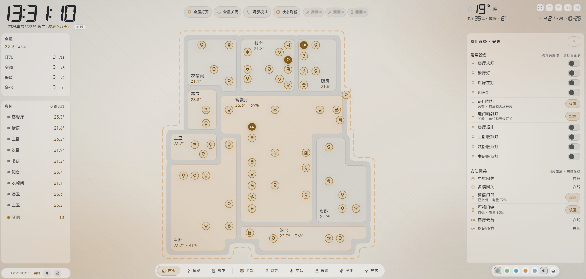
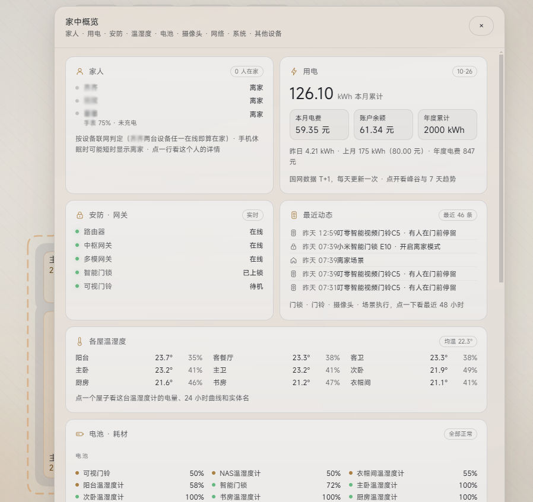
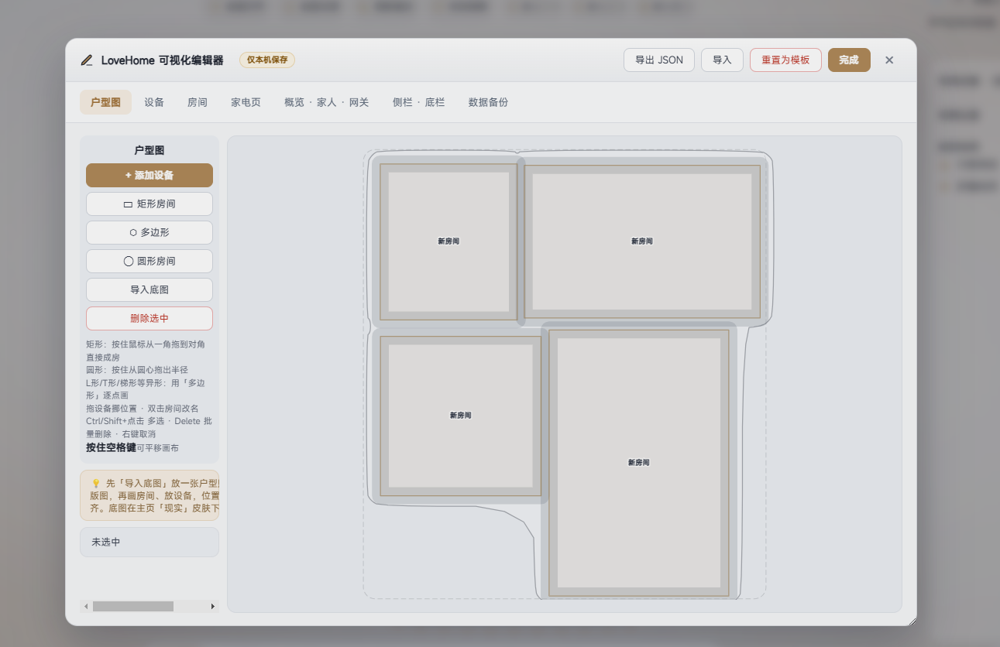
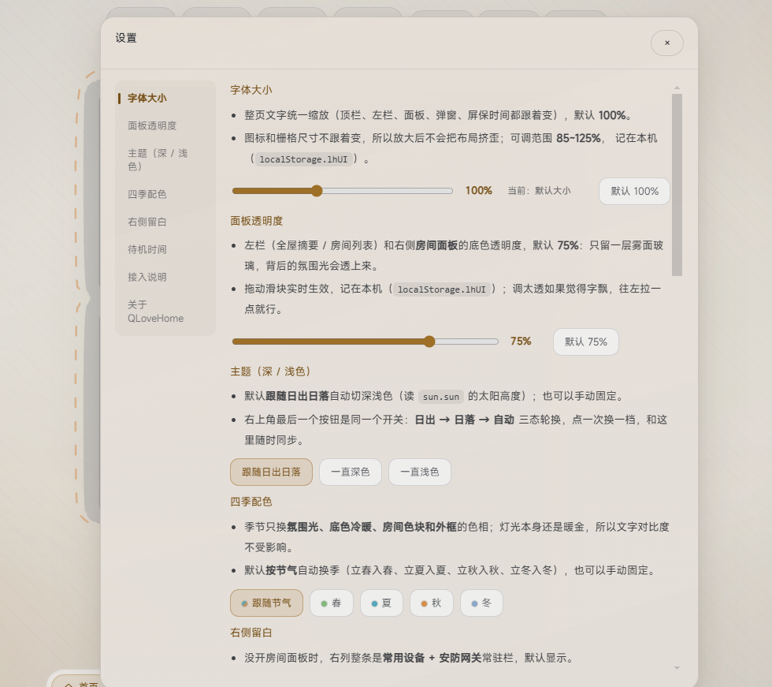
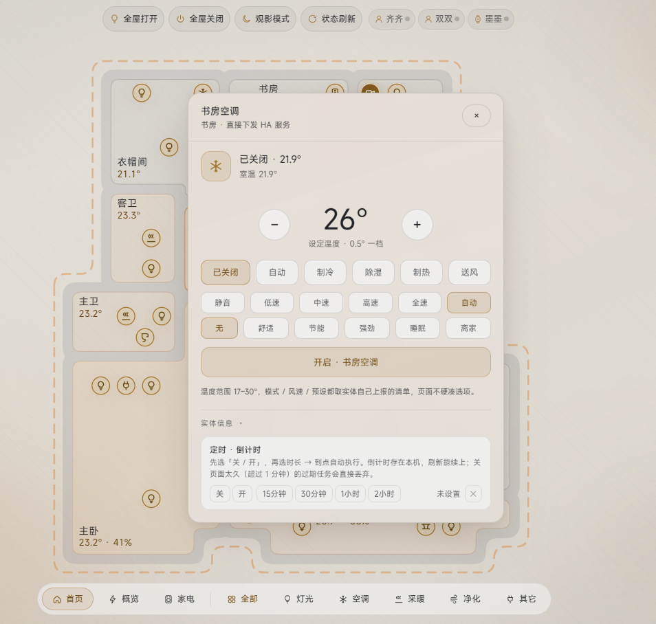

# 🏠 QLovehome · 全屋大屏

[](https://www.home-assistant.io/)
[](https://hacs.xyz/)
[](LICENSE)
[](https://github.com/MisiteQ/QLovehome/issues)
[](https://github.com/MisiteQ/QLovehome/stargazers)

> ⚠️ **这是一个非常初级的版本，还有很多问题，后续会慢慢修改完善。** 有需要的朋友可以在 [Issues](https://github.com/MisiteQ/QLovehome/issues) 提需求，也欢迎自行下载改进。

面向门口 / 客厅平板的 **Home Assistant 全屋大屏面板**。
可作为 **HAOS 应用（原加载项 / Add-on）** 或 **HACS 集成** 安装，零 YAML，零 Webpack——HTML + SVG + JS，源码可读可改。

---

## 💬 写在前面

QLovehome（**其爱家** 哈哈哈）是怎么来的？

> 新房子装修（开发商的精装房，几乎没啥装修的）之后，有几个灯的开关我老婆说不太好按，让我给她弄个方便操作的方式。当时没有接触过 HAOS，从淘宝上搜了几个蓝牙的还有那种"机器小手指头"的，但都不好用。
>
> 因为家里有个米家的摄像头，所以接触到了米家的智能开关，慢慢的就把家里的开关（主要是灯具，没换灯）都换成了米家的。后来又陆陆续续添加了部分米家的小家电，不过空调洗衣机还是用的美的的。
>
> 慢慢发现米家和美的不通，操作啥的还得俩 App。后来就接触到了 HAOS。不过对我一个小白来说，布置仪表盘啥的太麻烦了，中间停停弄弄的，一直也没弄成。
>
> 头几天在肥牛群里和群友交流，有人推荐了一个仪表盘我挺喜欢的。刚好最近 AI 都很火，我就尝试让 AI 给我布置了一个基础的，发现嘿，比我自己弄好多了！然后就让 AI 参照群友推荐的基础上给我布置了一个——不过这个是 AI 纯代码写出来的，和原来那个可能就在样式上有些相似，其他的都是现写的代码（我自己弄不明白 😅）。
>
> 发群里让大伙看，有人提出是不是可以弄成模板，所以就有了现在这个 QLovehome。是一个基础模板，可以手动设置自己家的户型，也可以直接导入平面图。
>
> **共享给大家，试试看吧，不会的交给 AI，一句话让他给你布置，哈哈哈！** 🎉

---

## ✨ 功能

| 模块 | 说明 |
|---|---|
| 🏠 **户型图** | 矢量 SVG，矩形 / 多边形 / 圆形房间，墙体自动融合一体 |
| 🎛️ **中控** | 灯光 · 插座 · 空调（含**扫风模式**）· 风扇 · 窗帘统一开关 + 调光调色温 |
| 📊 **概览** | 家人在线 · 用电 · 安防 · 温湿度 · 电池 · 摄像头 · 网络 · 天气 |
| 🌡️ **环境曲线** | 点各屋温湿度 → 24 小时温度 / 湿度走势 |
| 🔔 **家里最近发生** | 读取 HA 事件时间线（门锁、传感器、自动化等），一眼看到家里刚发生了什么 |
| 📝 **最近动态** | 自动记录设备操控 · 定时设置 · 定时到点执行，JSONL 存服务器，可按事件类型筛选 |
| ⏱️ **定时 / 倒计时** | 服务器端调度，关面板 / 退出账号也照跑，HA 重启自动恢复；支持手动输入分钟数 |
| 🔌 **子设备绑定** | 热水器绑水量传感器、灯绑子灯组，子设备自动从户型图剔除 |
| 🎨 **主题** | 深/浅色跟随日出日落 · 四季配色自动切换 · 房间色块温度感知 |
| 😴 **屏保** | 无操作自动进待机大屏时钟 · 待机时间可配置 |
| 🛠️ **编辑器** | 可视化画户型 · 从 HA 批量导入实体 · 空格平移画布 · 滚轮缩放 · 拖房间名字定位 · **右键直接编辑设备/房间** · **方向键微调位置** |
| 🔧 **个性化** | 字体大小 · 面板透明度 · 主题深浅 · 待机时间 · **全部存 HA 服务器**（换电脑/换浏览器不丢） |

---

## 📸 截图

| 首页（浅色主题） | 概览面板 |
|:---:|:---:|
|  |  |

| 编辑器 · 户型绘制 | 设置面板 |
|:---:|:---:|
|  |  |

| 房间详情（空调中控） | |
|:---:|:---:|
|  | |

---

## 🚀 安装

### ⭐ 方式一：HAOS 应用（原 Add-on，推荐）

**Home Assistant → 设置 → 应用 → 应用商店（App store，旧版叫「加载项」）→ 右上角 ⋮ → 添加应用仓库**

URL：
```
https://github.com/MisiteQ/QLovehome
```

点 **添加**（仓库根目录的 `repository.yaml` 会被自动识别）→ 列表里找到 **QLovehome** → **安装**

- Supervisor 自动构建（首次约 3-5 分钟）
- 安装完成后侧边栏自动出现 **QLovehome**
- 前端 + 后端独立进程，HA 重启后自动恢复定时任务

> 💡 详细应用安装说明见 [`qlovehome_addon/README.md`](qlovehome_addon/README.md)

### 方式二：HACS 自定义存储库（Integration 模式）

如果不想用 Supervisor 应用，也可以装成标准 HA 集成：

1. **HACS → 集成 → 右上角 ⋮ → 自定义存储库**
2. URL 填：`https://github.com/MisiteQ/QLovehome`
3. 类别选：**集成**
4. 搜索 **QLovehome** → 安装 → 重启 HA
5. **设置 → 设备与服务 → 添加集成 → QLovehome**
   - 侧边栏自动出现 **QLovehome** 入口 → 点进去就是
   - 如果没出现 → Dashboard 添加「网页卡片（iframe）」→ 地址：
     ```
     /qlh/www/index.html
     ```

### 方式三：纯 iframe（最简）

```bash
# 复制前端文件到 HA www 目录
cp -r custom_components/qlovehome/www/ /config/www/qlh/
```

Dashboard → 网页卡片（iframe）→ 地址：
```
/local/qlh/index.html
```

---

## 🔌 接线

### ⭐ 推荐：编辑器「从 HA 批量导入」（v1.1.0+）

**不用改任何 Python 脚本！**

1. 主界面**左下角铅笔图标** → 进入编辑器 → **设备 tab**
2. 点 **🔍 从 HA 批量导入**
3. 弹窗里按 domain 分组列出你 HA 里所有控制类实体（灯 / 开关 / 空调 / 窗帘 / 风扇 / 影音 / 门锁 / 摄像头...）
4. 勾选你家的设备 → 点「导入 →」
5. 系统自动：推断 kind（light 实体 → 灯图标）+ 取 friendly_name 当设备名
6. 继续配房间归属 + 户型图位置 → 保存

> 已经绑定过的实体会自动灰掉避免重复。超过 30% 设备实体不存在时 tab 头会显示黄色告警。

### 进阶：改 gen_qlovehome_data.py（适合大量设备 / 自定义房间名）

```bash
# 1. 改 gen_qlovehome_data.py 里的实体 ID 和房间
# 2. 生成数据层
python gen_qlovehome_data.py

# 3. 把生成的 qlovehome-data.js 传到 /config/www/qlovehome/
# 4. index.html 里的 ?v=N 加 1（浏览器缓存）
```

> **实体 ID 对不上不会报错**，只会显示「—」。先用批量导入跑通主要设备，特殊实体（概览里的家人/用电）再手改 gen 脚本。

---

## 🗺️ 换户型

| 方式 | 怎么做 | 适合 |
|---|---|---|
| ⭐ **A. 编辑器直接画** | 编辑器 → 户型 tab → 矩形 / 圆形 / 多边形工具直接绘制，拖拽调整 | **绝大多数人，推荐** |
| B. 现实风照片底板 | 照片存 `www/assets/plan-real.jpg`，跑 `python calib_real.py` | 想让照片当底板 |
| C. 重新提取多边形 | `python extract_rooms.py 标注图.png 户型图.png` | 户型完全不同 |

> ⚠️ B / C 需要仓库里的 Python 脚本，**HACS 发布包里不含**（见 `.hacsignore`）。想用就从 GitHub 克隆仓库，或直接用方式 A 在编辑器里画。

`rooms_poly.json` 是**唯一几何源头**——墙体、房间色块、标签位置全由它推导。

---

## ⌨️ 编辑器快捷键

| 操作 | 效果 |
|---|---|
| <kbd>Space</kbd> + 拖动 | 平移画布 |
| 滚轮 | 缩放（以鼠标位置为锚，0.3× ~ 5×） |
| <kbd>Ctrl/⌘</kbd> + <kbd>0</kbd> | 重置缩放和位置 |
| 矩形房间 | 按住从一角拖到对角 |
| 圆形房间 | 按住从圆心拖出半径 |
| 多边形 | 逐点点击画异形 |
| 双击房间 | 改名 / 拖拽房间名字移动 |
| 右键设备 / 房间 | 直接打开对应的设备 / 房间编辑弹窗 |
| <kbd>↑</kbd> <kbd>↓</kbd> <kbd>←</kbd> <kbd>→</kbd> | 移动选中项 1px；按住 <kbd>Shift</kbd> 移动 10px（房间会带着房内设备一起走） |
| <kbd>Delete</kbd> / <kbd>Backspace</kbd> | 删除选中 |
| <kbd>Ctrl/⌘</kbd> / <kbd>Shift</kbd> + 点击 | 多选 |
| 右键空白处 | 取消当前操作 |

---

## 📂 项目结构

```
QLovehome/
├── .github/workflows/validate.yaml   # CI: HACS + Python + JS + 三份副本一致性 + 版本号
├── scripts/sync-www.ps1              # 前端同步到两个发布目录（带 SHA256 校验）
├── .gitignore
├── .hacsignore
│
├── qlovehome_addon/                  # ⭐ HAOS 应用（原加载项，推荐）
│   ├── config.yaml                   #   Add-on 元数据（slug/ingress/架构）
│   ├── Dockerfile                    #   HA 基础镜像 + Alpine 预编译 aiohttp
│   ├── run.sh                        #   入口脚本（bashio 自动注入环境变量）
│   ├── README.md                     #   Add-on 专用说明页
│   ├── www/                          #   前端静态文件（自包含）
│   │   ├── index.html · qlovehome.js · qlovehome-editor.js
│   │   ├── qlovehome.css · qlovehome-data.js · QLovehome.png
│   │   └── assets/
│   └── server/                       #   独立 Python 后端（aiohttp）
│       ├── __main__.py               #     python -m server 入口
│       ├── app.py                    #     REST API + 静态文件托管
│       ├── ha.py                     #     HA WebSocket 连接层
│       ├── store.py                  #     配置 / 审计日志 / 版本持久化
│       ├── timer.py                  #     独立 asyncio 定时调度
│       └── manifest.json             #     版本号来源（Dockerfile 拷进容器）
│
├── repository.yaml                   # ⚠️ 必须在仓库根，Supervisor 靠它识别应用仓库
│
├── custom_components/qlovehome/       # ⭐ HA Integration（备选，和 Add-on 共用前端）
│   ├── __init__.py                    #   integration 注册 + WS/REST API
│   ├── config_flow.py                 #   HA 配置向导
│   ├── const.py                       #   常量
│   ├── manifest.json                  #   集成元信息（version / domain）
│   ├── brand/                         #   HACS brands 校验用图标
│   │   ├── icon.png (256×256) · icon@2x.png (512×512)
│   ├── strings.json
│   ├── translations/
│   └── www/                           #   前端静态文件（和 Add-on/www/ 同步）
│
├── qlovehome/                        # 前端源码（开发用，同步到两个 www/）
│
├── gen_qlovehome_data.py
├── extract_rooms.py
├── calib_real.py
├── templates.yaml
├── hacs.json
├── info.md
├── USER_GUIDE.md
├── LICENSE
└── README.md
```

---

## 🛠️ 开发

```bash
# 本地静态服务器（改前端时预览）
py -m http.server 8765 --directory qlovehome/

# 改完同步到两个发布目录（带 SHA256 校验，三份不一致会直接报错）
pwsh -File scripts/sync-www.ps1

# CI 自动校验：HACS validation · Python 语法（含 Add-on 后端）· JS 语法（三份副本）
#             · 三份前端逐字节一致 · JSON/YAML 可解析 · 版本号四处一致
```

### 核心几何算法

| 函数 | 作用 |
|---|---|
| `unionPolys()` | 多边形并集 + 扩张（扫描线 + Marching Squares） |
| `autoOutlineLoops()` | 户型自动外轮廓 |
| `traceLoops()` | 无方向端点连接串闭合环 |
| `scanlineFill()` | 每多边形独立扫描线填充 |
| `chaikin()` | Chaikin 算法平滑 |
| `roundPath()` | 带贝塞尔倒角的 SVG path |

---

## ❓ 常见问题

| 现象 | 原因 | 解决 |
|---|---|---|
| **Supervisor 添加仓库提示「无效的加载项仓库」** | 仓库里找不到根级 `repository.yaml` | 用最新代码（`repository.yaml` 已移到仓库根目录）；新版 HA 可能显示「无效的应用仓库」 |
| **应用安装卡在构建 / 构建失败** | 首次构建需拉 HA 基础镜像 + Alpine 包，网络慢 | 换 HA 的 Docker 镜像源后重试；看「设置 → 应用 → QLovehome → 日志」具体报错 |
| **应用启动后侧边栏没出现** | Ingress 面板未注册 / 浏览器缓存 | 重启应用；清缓存；或直接访问 `http://<ha-ip>:8123/api/hassio_ingress/` 下对应链接 |
| 侧边栏没出现 QLovehome（集成模式） | panel 注册可能失败 | Dashboard 手动加 iframe 卡片 → `/qlh/www/index.html` |
| 页面空白 | iframe 地址错 / 文件没传 / `?v=N` 没加 | 确认 Dashboard 卡片 URL；确认 `/config/www/qlovehome/` 下有 index.html |
| 全是「—」 | 实体 ID 没换成你的 | 打开开发者工具 → 控制台输 `LH.rooms.map(r=>r.lxs)` 看实际读的是什么 |
| 图标有但点不动 | 该设备的 HA 服务不存在 | HA → **开发者工具 → 服务** → 搜该设备 → 手动触发试试 |
| 改了没生效 | 浏览器缓存 | `?v=N` 加 1；还不行 Ctrl+Shift+R 硬刷新 |
| 手机侧栏不见 | 正常：≤900px 窄屏模式自动隐藏 | |
| 墙体太厚 | `LH.plan.wallW` 默认 10（画布单位，约 1.5% 宽度） | 编辑器里改房间形状后重新生成，或 Console 输 `LH.plan.wallW=6` |
| 待机时间想调 | 设置面板 | 设置 → 待机时间面板 |
| 体感温度显示 `≈` | 该天气实体没提供 `apparent_temperature`，用的是公式估算 | 换和风 / OWM / AccuWeather 等自带体感的集成，或忽略 |

---

## 📝 更新日志

| 版本 | 日期 | 变更 |
|---|---|---|
| **v1.6.0** | 2026-11-07 | 🏠 **全量对齐 lovehome 数据**：设备 / 房间读数 / 家电页 / 电池耗材 / 家人 / 国网用电 / 摄像头 / 网关 / 常用设备 / 情景全部补齐（74 台设备、32 项读数、11 个家电），原有户型图、平面图底图、设备位置与自定义卡片/形状/大小原样保留。<br>🌡️ **新增环境 24 小时曲线**：概览「各屋温湿度」点任意一间 → 温度 / 湿度 24 小时走势。<br>🔔 **新增「家里最近发生」**：直接读取 HA 事件时间线，门锁、传感器、自动化等刚发生的事一屏可见。<br>🛠️ **户型编辑器增强**：右键设备 / 房间直接打开对应编辑弹窗；<kbd>↑</kbd><kbd>↓</kbd><kbd>←</kbd><kbd>→</kbd> 微调选中项（<kbd>Shift</kbd> 加速到 10px），移动房间时房内设备一起走，连续按键只记一次撤销。<br>👨‍👩‍👧 **顶栏家人 chip 显示姓名**（未填名字时回退「家人 N」）。 |
| **v1.5.3** | 2026-11-07 | 🛠️ **户型编辑器多选对齐 / 等距平铺**：Ctrl / Shift 多选后可按左/中/右、上/中/下对齐，3 项以上支持水平 / 垂直等距平铺，房间按墙体包围盒计算、房内设备不重复位移。<br>🎨 **设备图标形状与大小**：圆形 / 方形 / 横条三种形状 + 60%~240% 缩放，编辑器右下角手柄直接拖大小。<br>📐 **斜墙拉直提示**：画异形房间时对接近水平/垂直的边给出拉直建议。<br>⚡ **顶栏预置默认情景**：回家 / 离家 / 观影 / 睡眠首次启动即可用。 |
| **v1.5.2** | 2026-11-07 | 🎛️ **空调 / 热水器面板补齐并汉化**：同一台设备下的模式、风速、扫风、水温、杀菌等功能不再遗漏，选项统一显示中文。 |
| **v1.5.1** | 2026-11-07 | 🐛 **设备主实体自动校正**：空调别被 `*_power` 开关占住、热水器别绑到水量传感器、灯别绑到指示灯，修复一批开关 / 灯具状态显示错误。<br>🛠️ 修复户型编辑器「图上添加设备」与空格平移画布的冲突。 |
| **v1.5.0** | 2026-11-07 | 🔗 **设备 / 房间绑定集成卡片或加载项面板**：编辑器里可视化选择面板来源（Q飞牛+ 设备卡 / 带 Ingress 的加载项 / 自定义 YAML），Q飞牛+ 弹窗卡自动展开为完整设备面板，不用再点一层。 |
| **v1.4.9** | 2026-11-07 | 🐛 修复窄屏 / 侧栏切换时响应式布局塌缩；补全「初级版本」声明。 |
| **v1.4.8** | 2026-11-07 | 🎨 **户型图外墙虚线重做**：改为「房间并集 → 欧氏距离变换 → 等距外扩」，虚线沿全部外墙外侧 15px 一圈贴合（呼吸位由 5px 加到 15px），凹凸台阶、错层都能跟着折弯；外凸/内凹拐角统一成半径一致的圆弧（原实现是按边长 1/4 切角，长边被切掉一大块、短边几乎不动，所以有的角鼓、有的角带棱）。墙体同步改用同一套外扩轮廓 + `evenodd` 扣房间，墙带与拐角交接无缝隙、无锯齿。<br>🐛 **修复「批量导入看不到设备」**：设备卡片所在的列表是 column flex，卡片带 `overflow:hidden` 会让 `min-height:auto` 退化成 0，几十台设备被压成一条条 2px 细线（看着像空白列表）。给 `.bulk-dev-card` 加 `flex:0 0 auto`，卡片恢复正常高度。<br>🎨 **修复「批量导入整片字看不清」**：弹窗挂在 `body` 下、不在 `.screen` 里，浅色主题的 `--text` 作用不到它，继承下来的是 `:root` 的深色值（`#eceff4`），白底上等于白字；另外 `--bg1~3` 是透明度数字、`--s3` 是 RGB 通道串，被当颜色用属非法值（回退也不生效）。现在弹窗自己定死一套浅底深字（正文 `#1f2430`、次要 `#6b7280`、徽章 `#9a6414`），徽章不折行、设备名不拆字、实体 id 超长省略。<br>↔️ **长名字自动滚动**：添加 / 编辑设备时实体名（`friendly_name` 经常是「客厅小米智能多模网关子设备墙壁插座」这种）在实体选择下拉、批量导入的设备卡片与展开的实体列表、设备列表行里，只要放不下就自动横向来回滚动，短名字完全静止；只在真的溢出时才启动动画（CSS keyframes + JS 量 `scrollWidth`）。<br>🧭 **边栏收起后户型图铺满空出来的位置**：原来第三列恒定 384px（房间面板 / 常驻栏互斥占用），两块都关掉后右边仍空着 384px，户型永远停在屏幕偏左。现在 `.stage` 会按右列是否可见切 `rp-off`，两块都不在时第三列收成 0，配合原有的 `hide-side`（第一列收 0），户型自动铺满并重新居中；开房间面板 / 点「首页」恢复常驻栏时又自动让回去，全程带 `.32s` 列宽过渡。<br>🐛 **修复「设备开关是一根长条」**：`.crow .csw` 原来写了 `flex:1 1 auto`，开关被拉满整行；改为 `flex:none` + 靠右，恢复 40×23 的小圆角开关。<br>⚡ **状态刷新提速 + 修复「关了开关界面还显示开，必须刷新页面」**：① 去掉 `paintValues()` 里 `document.hidden` 提前返回（在 HA 的 iframe 里这个判断不可靠，一旦被判成 hidden，整屏就再也不刷新了）；② 2 秒轮询原本只刷房间面板 / 常驻栏，**漏了控制弹窗**——现在 `paintValues()` 也调 `refreshControl()`，弹窗里的「开启 / 关闭」不会再停在旧文案；③ 新增**乐观显示**：点下发命令时界面立即切到目标态（云端设备回报常要 1–5 秒），真实状态一到自动撤掉覆盖，8 秒仍没跟上则退回真实状态，命令失败也不会一直显示错的开/关；④ 原来只有 2 秒轮询这一条刷新源，再加 350ms 的 `hass.states` 引用比对 + 300ms 节流，灯基本 0.4 秒内就有反馈。 |
| **v1.4.7** | 2026-11-06 | 🐛 **修复「顶部白条（QLovehome 标题栏）藏不掉」**：集成面板由 Home Assistant 的 `<hass-subpage>` 包着，那条白底标题栏是它 shadow DOM 里的 `.toolbar`（不是 `.header`），原先的样式注入既没扫 `hass-subpage` 这个标签、也没写 `.toolbar` 选择器，所以「隐藏 HA 顶栏」按钮和全屏联动都无效。现在把 `hass-subpage` / `ha-panel-app` 加入扫描列表，并把 `.toolbar` 藏掉的同时把 `.content` 高度补回 100%（否则底部会留 56px 空白） |
| **v1.4.6** | 2026-11-06 | 🐛 **修复发布包 zip 路径分隔符错误**（v1.4.4/v1.4.5 的包都有这个问题）：.NET Framework 的 `Compress-Archive` / `ZipFile.CreateFromDirectory` 会把目录分隔符写成反斜杠 `\`，在 Linux 上解压后 `www\index.html` 变成一个**文件名**而不是 `www/` 目录，集成找不到前端文件 → 静态目录注册失败 → 面板 iframe 404 → HA 回落到自己的界面 → 又是无限套娃。`scripts/package.ps1` 改为手工写 zip 条目并强制正斜杠，打包时自检：出现反斜杠条目直接失败退出 |
| **v1.4.5** | 2026-11-06 | 🐛 **修复「打开后 HA 无限套娃」**：前端静态目录原先挂在 `/qlovehome/www`，正好在侧边栏面板路径 `/qlovehome` 之下，访问静态页时被面板路由先命中，面板就在自己的 iframe 里再加载一次自己。现已改为 `/qlh/www`（与面板路径无关），并加了防呆检查——以后谁再把静态目录挂到面板路径下面会直接报错跳过。文档里的手动 iframe 地址同步改为 `/qlh/www/index.html`（复制到 www 目录的场景是 `/local/qlh/index.html`） |
| **v1.4.4** | 2026-11-06 | 📦 **修复发布包结构**：原先 zip 多包了一层 `QLovehome-vX.Y.Z/`，导致 `manifest.json` 落在第 3 层，冬瓜 HAOS 伴侣这类「从压缩包安装集成」的工具报「压缩包中未找到 manifest.json」。现在同时发布两种布局——`QLovehome-integration-vX.Y.Z.zip`（首层即 `manifest.json`，供此类工具）与 `QLovehome-vX.Y.Z.zip`（首层为 `custom_components/`，完整包）；新增 `scripts/package.ps1` 统一打包，避免手工压缩再次出错。集成代码与 v1.4.3 完全一致 |
| **v1.4.3** | 2026-11-06 | 🔄 **对齐 Home Assistant Core 2026.11 / 最新 HAOS**：① Add-on 基础镜像 `amd64-base:3.20` → `{arch}-base:3.22`（原写法把架构写死成 amd64，aarch64 设备会拉到错架构镜像）；② 移除已弃用的 `dt_util.utcnow()`，改用 `dt_util.now(timezone.utc)`；③ `manifest.json` 补 `homeassistant: 2025.1.0` 最低版本声明；④ 核查并确认其余接口（`async_register_static_paths` / `websocket_api.async_register_command` / `frontend.async_register_built_in_panel` / Ingress / Supervisor WebSocket）在 2026.11 下仍有效；⑤ 适配 2026.11 **实体命名重构**（`friendly_name` 变为「设备名 + 实体名」）——前端已有的去设备名前缀逻辑可直接覆盖，无需改代码，仅确认不会出现名字重复 |
| **v1.4.2** | 2026-11-05 | 🩹 **修复一批会静默出错的问题**：① 概览设置保存必抛 `RangeError`（`const $` 自遮蔽递归）；② 编辑器保存会把服务器配置里的 `ui` 段整段删掉（换设备丢主题/字号/待机）——两个后端现在都保留 `timers` + `ui`；③ 集成模式下「最近动态」永远为空（`with_suffix` 抛 `ValueError`）；④ 复合设备开关方向反了（`gas`/`unlocked` 算「开」但点击只认 `on`）、门锁被当成 `switch` 下发；⑤ 主实体是 climate 的设备「添加子设备」必崩；⑥ 删房间不清设备/读数引用、编辑器白屏；⑦ 触摸屏完全画不了房/拖不动（全量改 Pointer Events + `touch-action`）；⑧ 老设备自动迁移用了不存在的 `window.hass`，从没执行过；⑨ 加水印式 XSS：房间名/实体名/选项值直接拼 `innerHTML`，统一加 `esc()`。<br>🔒 **安全**：保存配置接口需要管理员（WS `require_admin` + REST 403），编辑器入口按 `is_admin` 隐藏；Add-on 直连端口默认拒绝（仅 Ingress / 本机 / `QLH_API_TOKEN`）。<br>⚡ **优化**：配置写入加锁（消除 save_config / save_ui 丢更新）、保存 600ms 防抖、几何膨胀改可分离两趟（大 pad 不再卡主线程）、页面隐藏时停止 2s 重绘、滑块静默期按实体记 8s、定时支持 cover/valve。<br>🧰 **工程**：新增 `scripts/sync-www.ps1` 三份前端同步 + SHA256 校验，CI 增加 Add-on 后端/两份副本/JSON-YAML/版本号一致性检查 |
| **v1.4.1** | 2026-10-29 | 🔧 **加载项安装修复**：`repository.yaml` 移到仓库根（否则 Supervisor 提示「无效的加载项仓库」）；移除 `config.yaml` 里的 `image:` 字段（无预构建镜像，改为 Supervisor 本地构建）；补 `web.get("/")` 根路由，修复 Ingress 面板打开显示 404；🧩 补齐 HACS brands 图标（`brand/icon.png` + `icon@2x.png`），CI 10/10 通过；📚 README / USER_GUIDE / info.md / 加载项 README 全面校对（修正遗留 `lovehome` 旧命名、`gen_qlovehome_data.py` 文件名、路径、localStorage 过时描述等） |
| **v1.4.0** | 2026-10-28 | ⭐ **新增 HAOS Add-on 模式**（独立 Python 进程 + HA WebSocket 连接 + Ingress 侧边栏，自包含 `qlovehome_addon/` 目录）；🗂️ 设备操控统一走后端 `/api/qlh/service`（两种模式都带审计日志），失败才回落直接 `hass.callService()`；📝 新增 **最近动态** 面板（底部 tab 栏，自动记录设备操控、定时设置、定时到点执行，JSONL 存服务器，支持事件类型筛选）；🔌 子设备绑定（热水器绑水量传感器、灯绑子灯组等，编辑器里可添加，子设备自动从户型图剔除）；❄️ 空调面板新增 **扫风模式**（读 `swing_modes` 属性，有才显示按钮）；🏷️ 版本号改从 `manifest.json` 动态读取，关于页面实时跟随更新 |
| **v1.3.4** | 2026-10-28 | 🏠 默认模板补上**过道 + 卫生间**（6 个房间铺满画布，每房一盏示例灯）；🐛 修复 HA 顶栏隐藏时报 `getElementById is not a function`（逐层扫描 shadow root 时对 Document 兼容取样式节点）；🩹 服务器配置只剩 `timers` 段时不再被误判为「已配置」，可正常回落到默认模板 |
| **v1.3.3** | 2026-10-28 | 🏠 默认模板改为**4 个房间铺满画布 + 每房一盏灯**（移除原来开发者自带的户型）；🪟 修复隐藏 HA 顶栏按钮无效（兼容 Lovelace `.header` 与新版 `ha-top-app-bar`，逐层注入 shadow DOM） |
| **v1.3.2** | 2026-10-28 | 👨‍👩‍👧 家人支持**一位家人挂多台设备**（手机 / 手表 / 平板）：编辑器里「+ 设备」逐个添加，任意一台在线即算在家；家人详情页会列出每台在线状态 |
| **v1.3.1** | 2026-10-28 | ⏱️ 定时 / 倒计时改由 **HA 服务器调度**：存在集成自身目录 `qlh/qlh-config.json` 的 `timers` 段，关面板 / 退出 HA 账号 / 换电脑都照常执行；支持**手动输入分钟数**（1~1440） |
| **v1.1.0** | 2026-10-27 | ⭐ 新增**编辑器批量导入**：从 HA 实际实体列表勾选创建设备（按 domain 分组、自动推断 kind/名字）；设备 tab 缺失实体告警；接线方式升级为「批量导入优先」 |
| **v1.0.1** | 2026-10-27 | 🔴 修复 `async_setup_entry` 崩溃（panel_custom API → frontend 内置注册）；manifest iot_class 改为 calculated |
| **v1.0.0** | 2026-10-27 | 首个正式发布：户型图可视化 + 四季主题 + 编辑器 + 房间标签拖拽 + HACS 集成 |

---

## 🤝 贡献

欢迎 PR！提交前请确保：
1. CI Actions 全绿（HACS validation + Python 语法 + JS 语法）
2. `manifest.json` 的 `version` 同步更新
3. 改了 `gen_qlovehome_data.py` 要重新跑一遍确认没 break

---

## 📄 许可

[MIT License](LICENSE) · 可以随便改、随便用。

初始版本来自一套真实家庭面板（脱敏处理），布局与交互逻辑原样保留。
